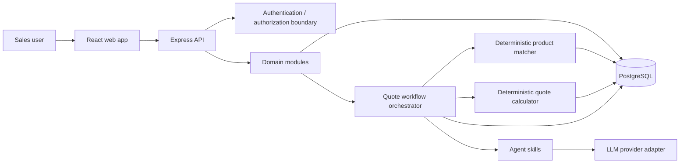

# System Architecture

## 1. Architectural style

A modular monolith for the MVP: one Express API, one React client, one PostgreSQL database. Organize the backend by business domain. Do not introduce microservices, queues, vector databases, or multi-agent frameworks unless a demonstrated requirement justifies them.

## 2. High-level components

## 3. Backend module boundaries

- `customers`: customer records and validation.
- `leads`: intake requests and lead lifecycle.
- `products`: catalog and eligibility attributes.
- `quotations`: draft lifecycle, line items, totals, approval.
- `agent`: orchestration, skills, schemas, prompts, provider abstraction.
- `infrastructure/database`: Prisma client and database configuration.
- `infrastructure/ai`: OpenAI adapter and mock adapter.
- `middleware`: request validation, not-found, error mapping, authentication.

A route/controller handles HTTP translation only. A domain service owns use-case behavior. Prisma access belongs behind service/repository boundaries appropriate to complexity; avoid unnecessary generic repository abstractions.

## 4. Agent workflow ownership

The API owns the sequence:
1. Validate the lead and request.
2. Create an `AgentRun` in `RUNNING`.
3. Call the AI request-analysis skill.
4. Validate the returned object with Zod.
5. Persist extracted requirements and missing fields.
6. If required information is missing, return a clarification result; do not proceed to quote generation.
7. If sufficient, call deterministic product matching.
8. Call deterministic quote calculation using catalog price snapshots and configured tax policy.
9. Ask the LLM to produce a plain-language explanation from validated facts.
10. Create a `DRAFT` quotation and mark the agent run successful.
11. Human user reviews and approves/rejects through a separate endpoint.

No model-controlled arbitrary tool loop. Each step is explicit, bounded, and testable.

## 5. Frontend responsibilities

- Display customers, leads, catalog and quotations.
- Collect request text and user-confirmed intake fields.
- Present extracted requirements and missing questions for review.
- Present product matches with reasons and source catalog identifiers.
- Show itemized calculations and assumptions.
- Allow editing permitted draft fields.
- Require a deliberate approval action.
- Display agent progress and actionable errors.

The frontend never calls the OpenAI API directly and never calculates authoritative totals.

## 6. Data flow and trust boundaries

- Browser input is untrusted; validate at API boundary.
- LLM output is untrusted; parse and validate with Zod.
- Catalog data is authoritative for product identity and configured price.
- Calculator output is authoritative for monetary totals.
- Approval is authoritative only when performed by an authorized user.
- UI-displayed totals come from the API, not client-side recomputation.

## 7. Architecture decisions

| ID | Decision | Reason |
|---|---|---|
| ADR-001 | Modular monolith | Fast to build and deploy; clear module boundaries without distributed-system overhead. |
| ADR-002 | Single guided agent | Bounded workflow, easier testing and interview explanation. |
| ADR-003 | LLM provider adapter | Isolate provider-specific SDK and enable mock tests. |
| ADR-004 | Zod validation at boundaries | Runtime safety for HTTP and model output. |
| ADR-005 | Deterministic pricing | Financial arithmetic must be reproducible and auditable. |
| ADR-006 | Human approval required | AI output is a draft, not a business commitment. |
| ADR-007 | Store quote price snapshots | Historical quote values must not change when catalog prices change. |
| ADR-008 | Configurable currency/tax | Avoid embedding jurisdiction-specific assumptions in code or prompts. |

## 8. Deployment shape

Deploy the React client and Express API as separate services, with a managed PostgreSQL database. Configure environment variables through the hosting provider. Use HTTPS, restricted CORS origins, database migrations, health checks, and CI build/test gates. Never expose database credentials or AI keys to the browser.

## 9. Explicitly deferred

Authentication provider selection, multi-tenancy, background jobs, streaming, observability vendor, rate limiting vendor, and production-grade audit retention are implementation decisions to revisit before real-world use. MVP must still enforce a basic authenticated/authorized approval boundary before presenting approval as secure.
