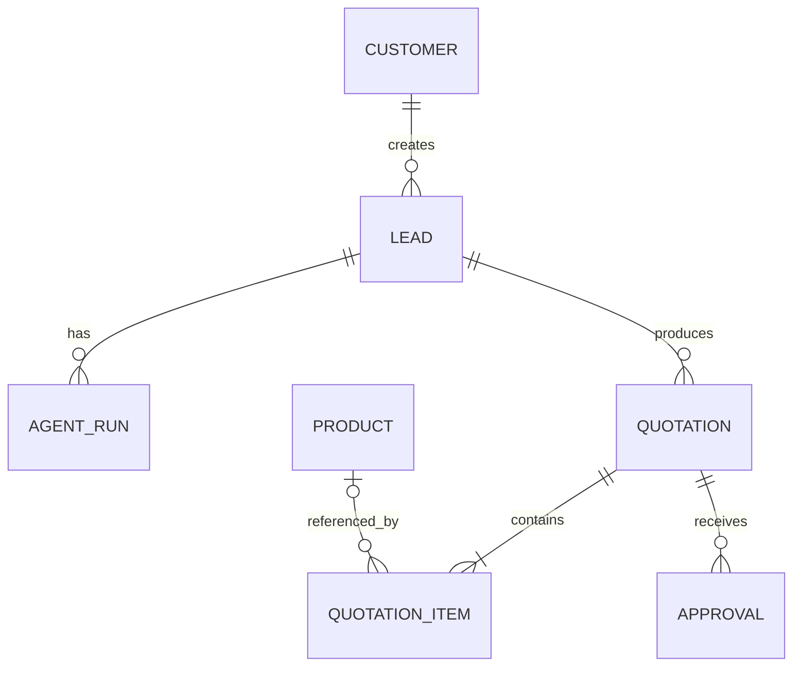

# Data Model — Initial Domain Contract

This document describes the conceptual model. Prisma schema details may refine field names and types, but changes must preserve the invariants below.

## Entities

### Customer
- `id`, `name`, `email?`, `phone?`, `createdAt`, `updatedAt`.
- Contact details are optional for synthetic/demo records.
- Validate and minimize personal data.

### Lead
- `id`, `customerId`, `status`, `requestText`, `installationPostcode?`, `createdAt`, `updatedAt`.
- Belongs to one customer.
- Request text is untrusted user content.
- Status lifecycle should be explicit (e.g. `NEW`, `ANALYZING`, `NEEDS_INFORMATION`, `QUOTED`, `CLOSED`).

### Product
- `id`, `sku`, `name`, `category`, `description`, `attributes`, `unit`, `unitPrice`, `currency`, `isActive`.
- SKU is unique.
- Monetary values use decimal-safe storage, never binary floating point.
- `attributes` must be validated/normalized enough for deterministic matching.
- Seed records are illustrative only.

### AgentRun
- `id`, `leadId`, `status`, `promptVersion`, `model`, `inputSummary`, `structuredOutput`, `missingInformation`, `errorCode?`, `startedAt`, `completedAt?`.
- Store only data needed for traceability; avoid unnecessary raw personal data.
- Status examples: `RUNNING`, `NEEDS_INFORMATION`, `SUCCEEDED`, `FAILED`.

### Quotation
- `id`, `leadId`, `status`, `currency`, `subtotal`, `taxRate`, `taxAmount`, `total`, `assumptions`, `explanation`, `createdAt`, `updatedAt`, `approvedAt?`, `approvedBy?`.
- Status lifecycle: `DRAFT`, `PENDING_REVIEW`, `APPROVED`, `REJECTED`.
- AI generation creates a draft only.
- Approval requires an authenticated/authorized actor.
- Approved quote totals are immutable; revisions create a new draft/version.

### QuotationItem
- `id`, `quotationId`, `productId?`, `skuSnapshot`, `nameSnapshot`, `unitSnapshot`, `quantity`, `unitPriceSnapshot`, `lineTotal`.
- Store product snapshots so historical quotes do not change when catalog data changes.
- Use decimal arithmetic and explicit rounding policy.
- A manually entered non-catalog item, if supported later, must be visibly distinguished and audited.

### Approval (optional separate table for MVP)
- `id`, `quotationId`, `actorId`, `decision`, `comment?`, `createdAt`.
- Prefer a separate record if multiple decisions/revisions must be auditable. Otherwise approved/rejected fields may be stored on the quote for the simplest MVP; document the trade-off.

## Relationships

## Invariants

1. Every lead belongs to a customer.
2. Every agent run belongs to a lead.
3. Every quotation belongs to a lead.
4. A quotation is created in `DRAFT` or `PENDING_REVIEW`, never `APPROVED` by AI.
5. A quote item stores product and price snapshots.
6. All items in a quotation use the quotation currency.
7. Currency precision and rounding are explicit.
8. Catalog price changes do not mutate existing quotation snapshots.
9. Only an authorized human can approve/reject.
10. Demo data must be labelled illustrative and must not be presented as supplier pricing.
